# Guía de Usuario Final

Sistema de gestión de la Vicaría de los Pobres, Pastoral de Adicciones (Casa Madre de Misericordia).

## Índice

1. [Introducción](#1-introducción)
2. [Requisitos previos](#2-requisitos-previos)
3. [Acceso al sistema](#3-acceso-al-sistema)
4. [Navegación general](#4-navegación-general)
5. [Funciones principales](#5-funciones-principales)
6. [Ejemplos de uso y buenas prácticas](#6-ejemplos-de-uso-y-buenas-prácticas)
7. [Preguntas frecuentes](#7-preguntas-frecuentes)

---

## 1. Introducción

### Qué es

Una aplicación web que reemplaza las planillas y los cuadernos de la Vicaría. Reúne en un solo lugar:

- la ficha de cada persona que atiende la institución,
- la asistencia diaria,
- la medicación de los residentes,
- el calendario de actividades,
- los colaboradores,
- el informe para Cáritas.

### Para qué sirve

- Que cualquier integrante del equipo encuentre en segundos la historia de una persona.
- Que la asistencia y las tomas de medicación queden registradas el mismo día.
- Que los informes institucionales salgan sin rearmar planillas a mano.
- Que cada persona vea solo la información que le corresponde según su función.

### Quiénes lo usan

| Rol | Quién es | Qué hace en el sistema |
|---|---|---|
| **Referente** | Responsable de la institución | Todo: fichas, asistencia, medicación, calendario, colaboradores, usuarios, informes y respaldos |
| **Directora de Casa de Convivencia** | Responsable de la casa donde viven los residentes | Fichas e historia de vida, estadías, evaluaciones psiquiátricas, medicación y stock, visitas y asistencia |
| **Coordinador de Casa de Convivencia** | Acompaña el día a día de la casa | Ve fichas de residentes, carga observaciones y asistencia, marca tomas de la agenda de medicación y registra visitas |
| **Escucha** | Voluntario que recibe a las personas | Ve fichas, carga observaciones y la asistencia del día, y consulta el calendario |

> Si no ves una opción que aparece en esta guía, es porque tu rol no tiene ese permiso. Pedíselo al Referente.

## 2. Requisitos previos

### Requisitos técnicos

- Una computadora, tablet o celular con conexión a internet.
- Un navegador actualizado: Google Chrome (recomendado), Microsoft Edge o Firefox.
- No hace falta instalar nada: el sistema se usa desde el navegador.
- En el celular funciona igual; el menú se abre con el botón ☰ de arriba a la izquierda.

### Requisitos de acceso

- Una cuenta con tu correo electrónico y una contraseña.
- Que el Referente haya **aprobado** tu cuenta y te haya asignado un **rol**.

## 3. Acceso al sistema

Entrá a la dirección del sistema que te pasó el Referente. Se abre la pantalla de inicio de sesión.

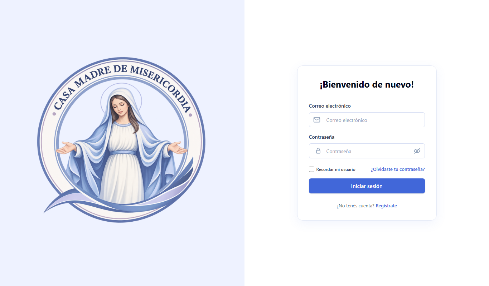

### Crear una cuenta (primera vez)

1. Hacé clic en **Registrate**.
2. Completá nombre, apellido, correo y contraseña.
   - La contraseña debe tener al menos 8 caracteres.
3. Confirmá. La cuenta queda **pendiente de aprobación**.
4. El Referente recibe una notificación, aprueba tu cuenta y te asigna un rol. Desde ese momento podés entrar.

### Iniciar sesión

1. Escribí tu correo y tu contraseña.
2. Hacé clic en **Iniciar sesión**.

Tené en cuenta:

- Si te equivocás de contraseña **5 veces seguidas**, la cuenta se bloquea **30 minutos** por seguridad.
- Si dejás el sistema sin usar 30 minutos, la sesión se cierra sola. Volvé a iniciar sesión.
- Para salir, usá **Cerrar sesión**, al final del menú.

## 4. Navegación general

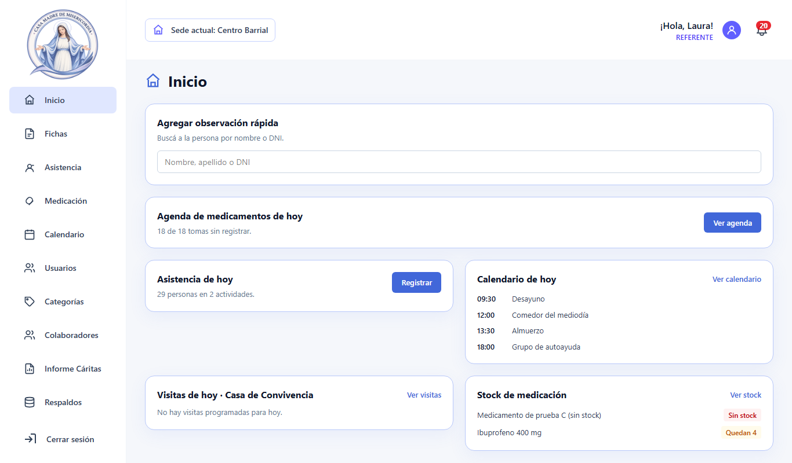

La pantalla tiene tres zonas.

**1. Menú lateral (izquierda).** Lleva a cada módulo y muestra solo los que permite tu rol.

| Opción | Para qué sirve |
|---|---|
| Inicio | Resumen del día: observación rápida, tomas y asistencia de hoy, calendario, visitas, stock bajo y, para el Referente, estadísticas de asistencia |
| Fichas | Listado, búsqueda y alta de fichas de personas |
| Asistencia | Registro diario de quién vino a cada actividad |
| Medicación | Agenda de tomas del día y acceso al stock de medicamentos |
| Calendario | Eventos generales, eventos personales y visitas a la Casa de Convivencia |
| Usuarios | Aprobación de cuentas, cambio de rol y baja (solo Referente) |
| Categorías | Categorías de las observaciones (solo Referente) |
| Colaboradores | Voluntarios y donantes de la institución |
| Informe Cáritas | Informe estadístico trimestral o semestral (solo Referente) |
| Respaldos | Copias de seguridad de la base de datos (solo Referente) |
| Cerrar sesión | Sale del sistema |

**2. Barra superior.**

- **Sede actual:** dónde estás trabajando (Centro Barrial o Casa de Convivencia).
- **Saludo con tu nombre y tu rol.**
- **Campana 🔔:** notificaciones. El número rojo indica cuántas no leíste: cuentas pendientes de aprobar, stock bajo, evaluaciones por vencer, respaldos fallidos, etc.

**3. Área de trabajo (centro).** El contenido del módulo elegido.

### Íconos y símbolos comunes

| Símbolo | Significado |
|---|---|
| 👁 (ojo) | Ver el detalle |
| ✏️ (lápiz) | Editar |
| ✕ | Borrar el texto de búsqueda o cerrar una ventana |
| **+ Nueva…** | Crear un registro nuevo |
| Etiqueta verde **Activo** | La persona sigue viniendo |
| Etiqueta gris **Inactivo** | La persona dejó de venir (se marca sola a los 30 días sin asistencia) |
| Etiqueta **Residente** / **Ambulatorio** | Vive en la Casa de Convivencia / viene al Centro Barrial |
| Botón azul | Acción principal de la pantalla |
| Botón rojo | Acción que no se puede deshacer; siempre pide confirmación |

### Flujo básico

**Iniciar sesión → Inicio → elegir un módulo en el menú → buscar o crear → guardar.**

Cada pantalla de detalle tiene un botón **← Volver** para regresar al listado.

## 5. Funciones principales

### 5.1 Fichas de personas

#### Buscar una ficha

1. Entrá a **Fichas**.
2. Escribí en el buscador un nombre, apellido, DNI o fecha de nacimiento. No importan los acentos ni las mayúsculas.
3. Presioná **Enter** o **Buscar**.
4. Para afinar, usá los **Filtros**: fecha de ingreso, sin observaciones, con o sin DNI, con o sin domicilio. Después, **Aplicar filtros**.

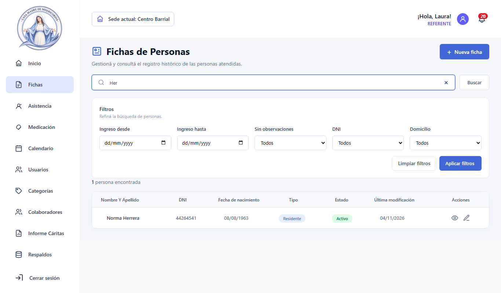

#### Crear una ficha

1. En **Fichas**, hacé clic en **+ Nueva ficha**.
2. Completá los datos personales. Son obligatorios el nombre y el apellido; el DNI, si lo tiene.
3. Elegí el **tipo de persona**: Ambulatorio o Residente.
4. Completá el contacto, la información de ingreso y los campos para Cáritas.
5. Hacé clic en **Guardar**.

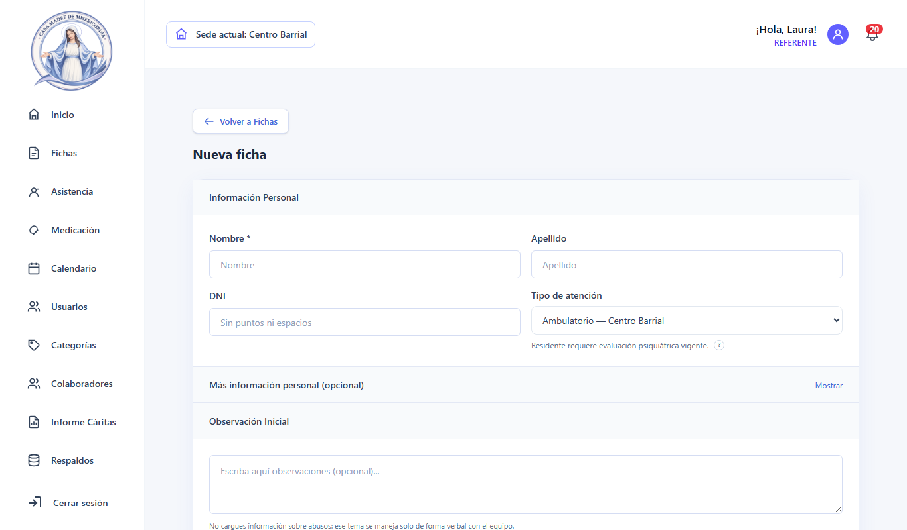

#### Ver el perfil de una persona

Hacé clic en el ojo 👁 de la fila. El perfil tiene pestañas:

| Pestaña | Contenido |
|---|---|
| Datos | Datos personales, contacto, ingreso y estadía |
| Observaciones | Notas del equipo por categoría, con fecha y autor |
| Historia de vida | Relato por etapas (infancia, adolescencia, adultez…) |
| Historial de asistencia | Días y actividades a los que vino |
| Medicación | Esquemas de medicación activos e historial de tomas |
| Evaluaciones | Evaluaciones psiquiátricas y su vencimiento |
| Documentos | Archivos adjuntos (DNI escaneado, certificados, etc.) |

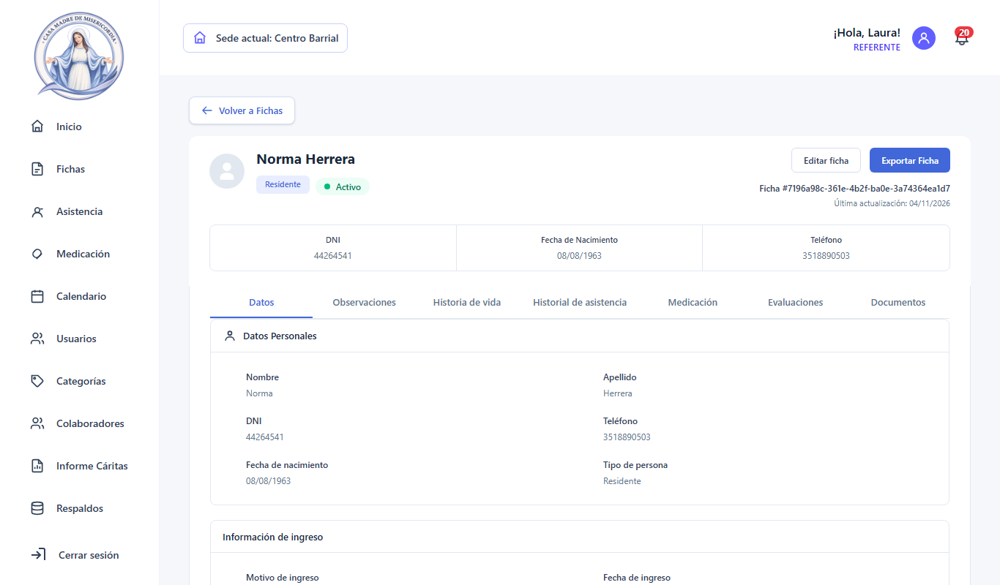

#### Editar una ficha

1. En el perfil, hacé clic en **Editar ficha**. También podés usar el lápiz ✏️ del listado.
2. Cambiá lo necesario y hacé clic en **Guardar**.
3. Si salís sin guardar, el sistema te pregunta si querés descartar los cambios.

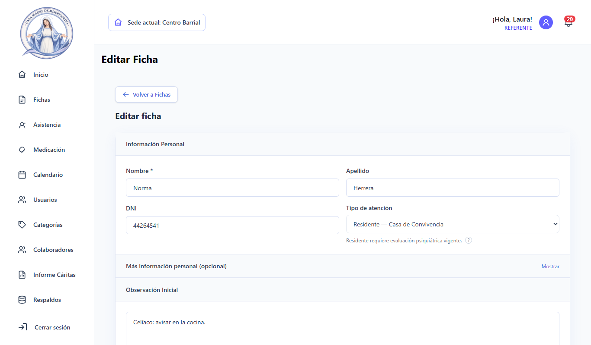

#### Cambiar el estado (activo o inactivo)

Desde el perfil, con **Marcar como Inactivo** o **Marcar como Activo**. Siempre se pide un motivo, y el cambio queda en el historial de estado.

Además, el sistema la pasa sola a **Inactivo** después de 30 días sin asistencia, y la reactiva cuando se le vuelve a registrar asistencia.

> Las fichas **no se eliminan**: la historia de cada persona se conserva siempre. En vez de borrarla, se la marca como inactiva.

#### Observaciones

1. En el perfil, abrí la pestaña **Observaciones** y hacé clic en **+ Nueva observación**.
2. Elegí la categoría, escribí el texto y guardá.
3. Para buscar observaciones, filtrá por categoría, fecha o texto.
4. **Exportar informe** descarga las observaciones filtradas.

#### Documentos adjuntos

En la pestaña **Documentos** podés subir archivos PDF o imágenes y descargarlos. Solo el Referente puede borrarlos.

#### Exportar la ficha completa

En el perfil, **Exportar Ficha** (solo Referente) genera un PDF con todos los datos de la persona, listo para imprimir.

### 5.2 Asistencia diaria

1. Entrá a **Asistencia**.
2. Elegí la pestaña: **Hogar de día** o **Casa de Convivencia (diaria)**.
3. Elegí una o varias **actividades** y la **fecha**. Por defecto es hoy.
4. Buscá a cada persona por nombre o DNI (al menos 2 letras) y marcala.
   - La lista de la derecha muestra quién ya está registrado.
   - **Quitar** saca a una persona de la lista.
5. Si vinieron personas **sin ficha**, cargá cuántas fueron en el contador, para que cuenten en las estadísticas.

Algunas reglas del sistema:

- Una persona no se puede marcar dos veces en la misma actividad y el mismo día.
- Los días anteriores quedan **cerrados**. Solo el Referente puede modificarlos, y tiene que escribir una justificación, que queda registrada.
- **Configurar actividades** (solo Referente) permite crear, activar o desactivar actividades.

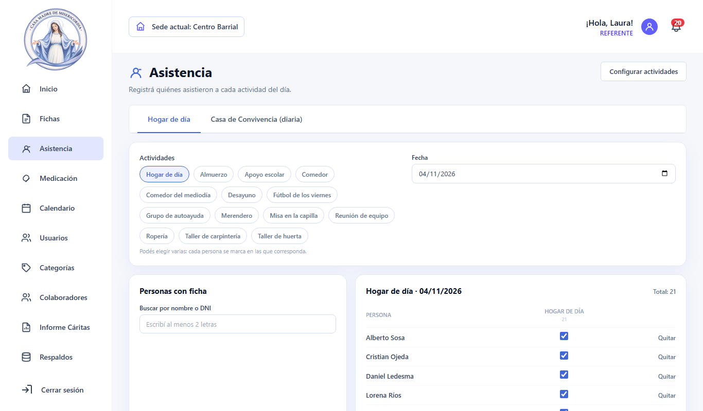

### 5.3 Estadísticas de asistencia (Referente)

Están al final de la pantalla de **Inicio**.

- Elegí el rango **Desde / Hasta** y, si querés, una **Actividad**.
- La pantalla muestra:
  - las presencias totales, comparadas con el período anterior;
  - los promedios por día, semana y mes;
  - la asistencia por actividad;
  - la lista de personas que **dejaron de venir hace más de 14 días**.
- Para descargar el resumen mensual en PDF, elegí el **Mes a exportar** y hacé clic en **Exportar a PDF**.

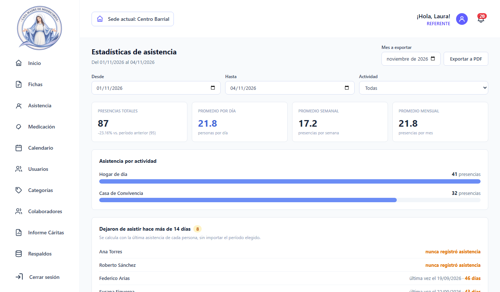

### 5.4 Medicación

#### Esquema de medicación de un residente

Desde el perfil del residente, en la pestaña **Medicación**:

1. Hacé clic en **Cargar medicamento**.
2. Elegí el medicamento, la dosis, los horarios y las fechas de inicio y fin.
3. Guardá.

Para crear el esquema se necesita una evaluación psiquiátrica vigente y stock suficiente del medicamento. Si falta alguna de las dos cosas, el sistema te avisa.

#### Agenda del día

1. Entrá a **Medicación**. Ves las tomas de hoy agrupadas por horario.
2. Para cada toma, hacé clic en **Administrada** o en **No administrada**. Podés agregar una observación opcional.
3. Cada toma administrada descuenta del stock.

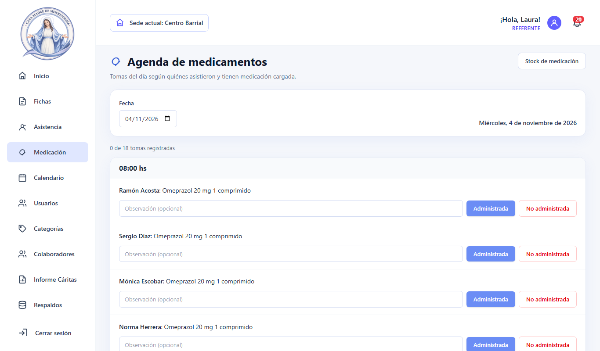

#### Stock de medicamentos (Referente y Directora)

En **Medicación → Stock de medicación** podés:

- registrar ingresos,
- ver los movimientos de cada medicamento,
- definir el **umbral de stock bajo**. Cuando el stock baja de ese número, llega una notificación.

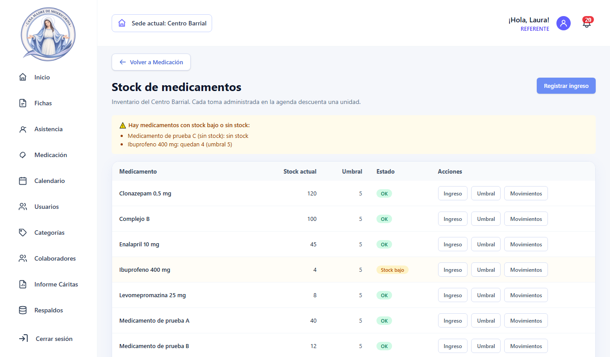

#### Historial de tomas

En la pestaña **Medicación** del perfil, **Exportar PDF** descarga el historial de tomas de la persona.

### 5.5 Calendario

- **General:** actividades de la institución, visibles para todos. Solo el Referente crea, edita y borra eventos. Los eventos pueden repetirse (diario, semanal, mensual).
- **Personal:** tus propios eventos. Solo los ves vos.
- **Visitas:** visitas a la Casa de Convivencia, con su estado. El sistema avisa si una visita se superpone con otra.

Para crear un evento:

1. Hacé clic en **Nuevo evento**.
2. Completá el título, la fecha, el horario y la repetición.
3. Guardá.

Para editar o borrar un evento, hacé clic sobre él.

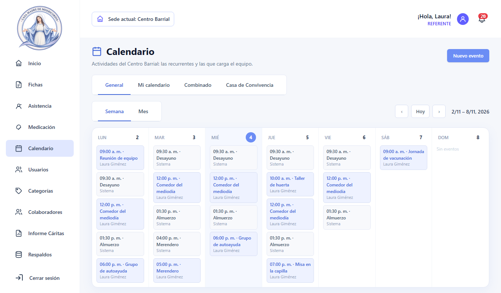

### 5.6 Colaboradores

En **Colaboradores** podés:

- buscar por nombre o tipo de colaboración,
- ver el detalle de cada uno,
- dar de alta, editar o dar de baja (solo Referente).

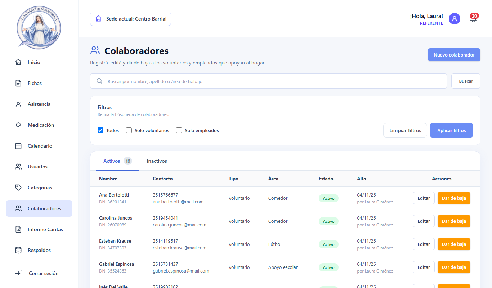

### 5.7 Usuarios (Referente)

En **Usuarios** ves las cuentas **pendientes**, activas e inactivas. Para cada una podés:

- **aprobarla** y asignarle un rol,
- **rechazarla**,
- **cambiarle el rol**,
- **darla de baja** o reactivarla.

Todas estas acciones quedan registradas en la auditoría.

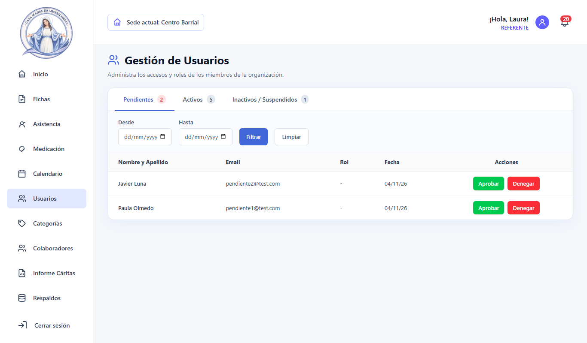

### 5.8 Informe para Cáritas (Referente)

1. Entrá a **Informe Cáritas**.
2. Elegí **Trimestral** o **Semestral** y la fecha **Hasta**. El sistema muestra el período exacto que va a informar.
3. Hacé clic en **Generar informe**.
4. Revisá los totales por motivo, sexo, edad y procedencia.
5. Hacé clic en **Exportar PDF** para descargarlo, o en **Imprimir**.

Con **Campos del informe** se editan los valores posibles de cada campo (por ejemplo, los motivos de ingreso).

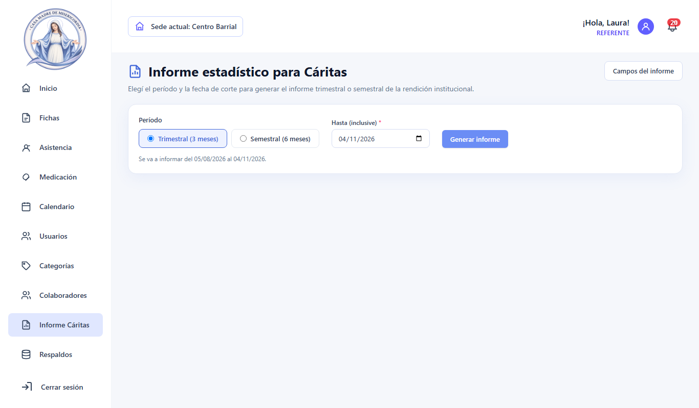

### 5.9 Respaldos (Referente)

El sistema hace una copia de seguridad de la base de datos **todos los días** y guarda las últimas. En **Respaldos** ves el historial de cada copia: fecha, estado y tamaño. Desde ahí también podés:

- **descargar** una copia.

Si un respaldo falla, llega una notificación.

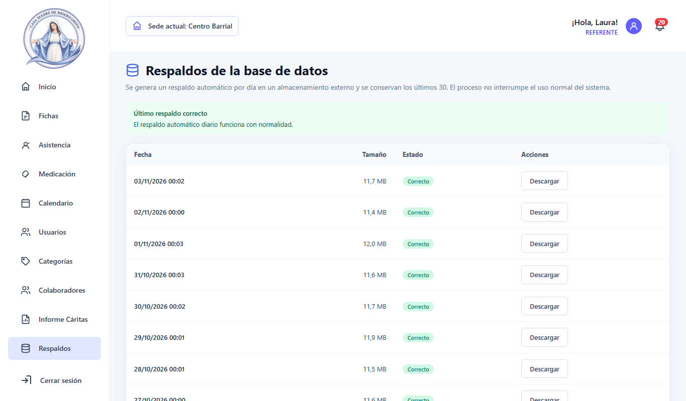

### 5.10 Categorías de observaciones (Referente)

En **Categorías** se crean, renombran y desactivan las categorías que se usan al cargar observaciones. Una categoría que ya tiene observaciones no se puede borrar; solo se puede desactivar.

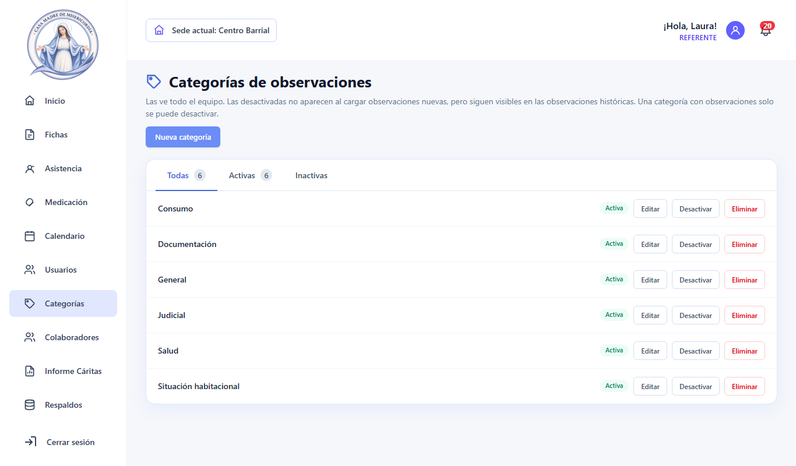

### 5.11 Uso en el celular

En pantallas chicas, el menú se oculta. Abrilo con ☰, arriba a la izquierda. Las tablas se pueden desplazar hacia los costados.

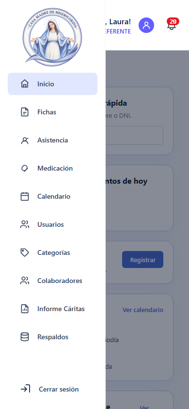

## 6. Ejemplos de uso y buenas prácticas

### Ejemplo 1: llega una persona nueva al Centro Barrial (Escucha y Referente)

1. La Escucha busca a la persona en **Fichas** por nombre o DNI, para confirmar que no tenga ficha.
2. Si no tiene, el Referente hace clic en **+ Nueva ficha**, la carga como **Ambulatorio** y guarda.
3. La Escucha la marca en **Asistencia**, en la actividad del día.
4. Después de la charla, carga una **Observación** en su perfil con la categoría que corresponda.

### Ejemplo 2: ingreso a la Casa de Convivencia (Directora)

1. Cargar la **evaluación psiquiátrica** en la pestaña **Evaluaciones** del perfil.
2. Pasar a la persona a **Residente** y registrar el **ingreso** de la estadía. Sin una evaluación vigente, el ingreso queda bloqueado.
3. Crear el **esquema de medicación**.
4. Desde el día siguiente, las tomas aparecen en la **agenda de Medicación**.

### Ejemplo 3: cierre de mes (Referente)

1. **Asistencia → Estadísticas**: revisar quiénes dejaron de venir y descargar el **PDF mensual**.
2. **Medicación → Stock**: revisar los medicamentos por debajo del umbral.
3. Al cierre del trimestre, en **Informe Cáritas**, generar y exportar el informe.

### Buenas prácticas

- **Buscá antes de crear** una ficha, así no se duplican personas.
- **Registrá la asistencia y las tomas el mismo día.** Los días pasados quedan cerrados y modificarlos exige justificación.
- **Escribí observaciones claras y con categoría.** Las va a leer otra persona del equipo.
- **No compartas tu usuario.** Cada acción queda registrada a tu nombre.
- **Cerrá sesión** al terminar, sobre todo en computadoras compartidas.
- **Revisá la campana 🔔** cada día: ahí llegan los avisos de stock bajo, evaluaciones por vencer y respaldos.
- Los datos son sensibles. **No descargues fichas ni informes en dispositivos personales** si no es necesario.

## 7. Preguntas frecuentes

**No puedo entrar y dice que la cuenta está pendiente.**
El Referente todavía no aprobó tu cuenta. Avisale.

**Dice que la cuenta está bloqueada.**
Hubo 5 intentos fallidos de contraseña. Esperá 30 minutos y volvé a intentar.

**No veo un menú que sí ve un compañero.**
Tienen roles distintos. El Referente puede revisar tu rol en **Usuarios**.

**Me equivoqué en la asistencia de ayer.**
Pedíle al Referente que la corrija. Puede modificar días cerrados escribiendo una justificación.

**No puedo registrar el ingreso o la medicación de un residente.**
Falta una evaluación psiquiátrica vigente (vencen a los 6 meses). Cargala primero en la pestaña **Evaluaciones**.
